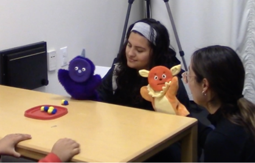

I am actively involved in two lines of inquiry.

**(1) Multicultural Social and Emotion Navigation**
{: .align-right width="400px"} 

My first line of research concerns the role individuals play in others’ emotion communication. Whereas it is known that individuals help others overcome communication gaps by interpreting language and cultural norms for others (i.e., cultural brokering), less is known about the process by which individuals interpret emotions for others (i.e., emotion brokering). I conducted research to (a) document the experience of emotion brokering and (b) investigate the associations between emotion brokering and psychological well-being among Latinx emerging adults predominantly from immigrant families (Subramoney et al., 2025a; Subramoney et al., 2025b). Findings advance knowledge on cultural brokering (Subramoney et al., 2025c) by establishing emotion brokering as a distinct form of cultural brokering and highlight the importance of considering heterogeneity in individuals' emotions and cultural values when understanding cultural brokers' experiences. Building on this earlier work, I have explored the role of the sociocultural context in the emotion brokering process. For instance, findings demonstrate gender differences in the associations between emotion brokering and relationship quality (Subramoney, Walle, Main, & Magaña, under review) and indicate that the associations between emotion brokering and psychological well-being are also evident in other cultural settings (i.e., South Africa, Subramoney & Walle, in prep). 

**(2) Development of Social and Cultural Navigation**
{: .align-right width="300px"}

My second line of research seeks to investigate the developmental processes that underlie flexible social navigation (Walle, Özden, Subramoney, & Ganesh Kumar, in press). For instance, with funding from the Oppenheimer Memorial Trust, I examined 5- to 10-year-old children's ability to learn novel emotion expression norms and teach those emotion norms to a social partner (Subramoney & Walle, under review). Furthermore, I have been investigating the role of sociocultural processes (e.g., socialization) in the development of flexible social navigation (Subramoney et al., under review; Subramoney, Williams, Lozada et al., in prep). This research advances developmental science and informs understanding of development in diverse and multicultural contexts (Subramoney, Walle, & Camras, in press).
